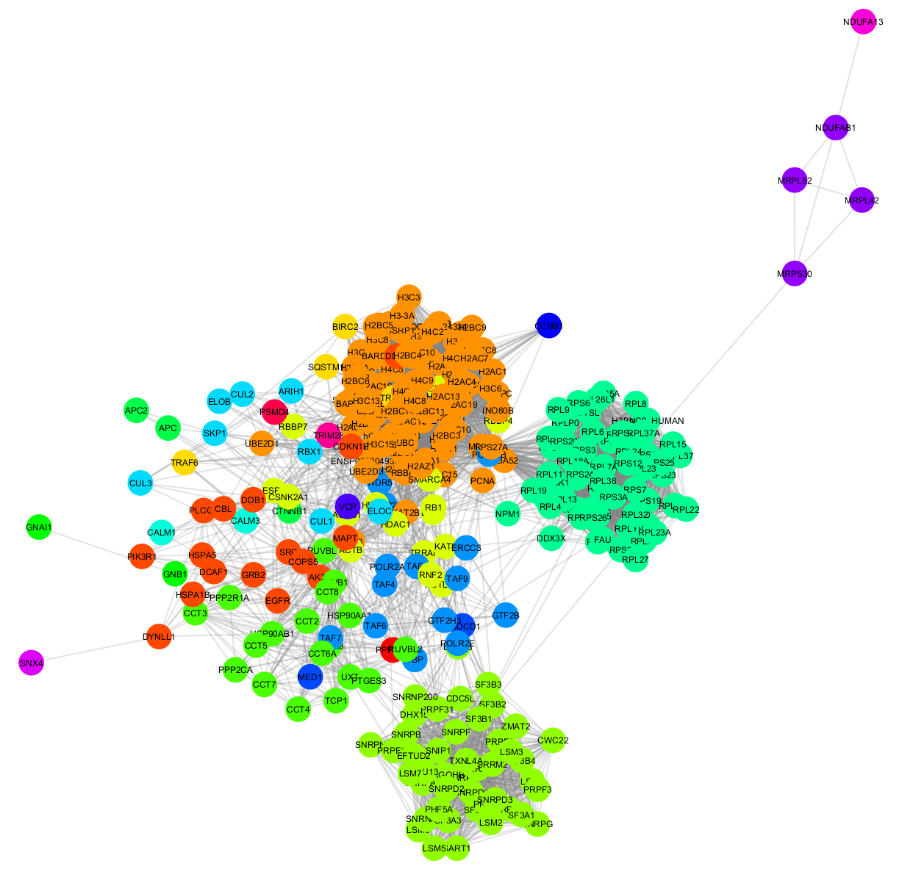
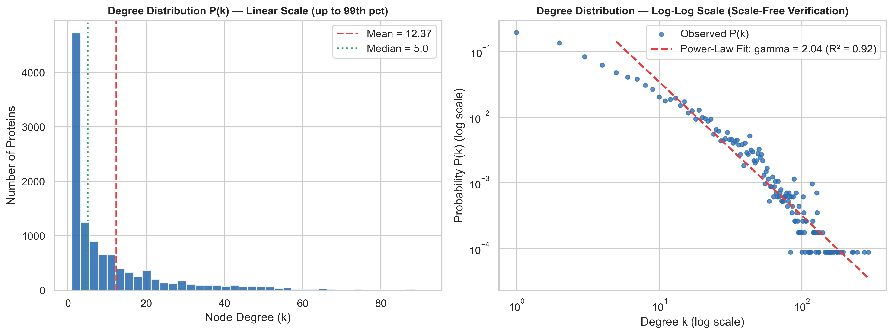

# Human Physical Protein-Protein Interaction (PPI) Network — SNA & Feature Engineering

**Course:** Introduction to Social Networks — Alexandria University, Faculty of Computers & Data Science (FCDS)  
**Scope:** Part A (Social Network Analysis, Community Detection, Cytoscape Visualization & ML Feature Export)  
**Dataset:** [STRING Database v12.5](https://string-db.org/) — *Homo sapiens* (`9606`) Physical Subnetwork (Highest Confidence $\ge 900$)

---

## Core Interactome Communities (Cytoscape — Top 300 Hubs, Louvain $Q = 0.8146$)



Purely from graph topology (without biological labels), **Louvain Modularity Optimization ($Q = 0.8146$)** automatically separates the core human interactome into real cellular molecular machines:
- **Orange (Top Center):** Chromatin, Histone Nucleosome & Ubiquitin-DNA Repair Core (`H2A/H2B/H3/H4`, `UBC`, `RPS27A`, `PCNA`)
- **Mint-Teal (Right):** Cytosolic Ribosome (`RPL9`, `RPL15`, `RPS6`, `RPL27`, `NPM1`)
- **Purple (Upper Right):** Mitochondrial Ribosome & Respiratory Chain (`MRPS30`, `MRPL42`, `MRPL52`, `NDUFAB1`)
- **Lime-Green (Bottom):** The Spliceosome (`SF3B1`, `SF3B3`, `SNRNP200`, `PRPF31`)
- **Red-Orange (Mid-Left):** Growth-Factor Signaling & Neuronal Tau Pathway (`EGFR`, `GRB2`, `MAPT`, `PIK3R1`)
- **Bright-Green (Lower-Left):** TRiC/CCT Chaperonin Folding Complex (`CCT2`–`CCT7`, `TCP1`, `HSP90AB1`)
- **Blue (Center):** RNA Polymerase II Transcription Complex (`POLR2A`, `TAF4`–`TAF9`, `GTF2B`, `MED1`)

---

## Key Network Findings (Full Interactome: 11,442 Proteins)

| Metric | Value | Scientific / SNA Interpretation |
|---|---|---|
| **Nodes ($N$) / Edges ($E$)** | **11,442** / **70,797** | Simple, undirected, highest-confidence ($\ge 900$) physical binding graph |
| **Density ($D$) / Sparsity** | **0.001082** / **99.89% zeros** | Sparse $11,442 \times 11,442$ symmetric adjacency matrix |
| **Average / Median / Max Degree** | **12.37** / **5.0** / **292** | Handshaking verified: $\sum k_i = 2E = 141,594$ |
| **Scale-Free Exponent ($\gamma$)** | **$\gamma = 2.038$** ($R^2 = 0.915$) | Ultra-small scale-free biological regime ($2 < \gamma < 3$) |
| **Connected Components** | **443** (Giant: **10,196**, **89.11%**) | Plus 438 isolated small complexes (e.g., `FLRT3—ADGRL3—TENM2` synaptic triad) |
| **Bridges / Articulation Points** | **2,228** / **1,524** | Structural bottlenecks & single-point-of-failure proteins |
| **Exact Diameter / Avg Path Length** | **16 hops** / **4.9764 hops** | Computed via chunked C-level BFS (`scipy.sparse.csgraph`) |
| **Small-World Verification** | **$C = 0.4692$** vs. **$C_{\text{rand}} = 0.00134$** | **351× higher clustering** than random with logarithmic path length |
| **Louvain Communities / Modularity** | **495** / **$Q = 0.8146$** | Strong modular organization into biological complexes |

### Centrality Leaders
- **#1 Closeness Centrality:** `TP53` (`0.2855`) — Tumor suppressor p53 sits at the geometric center of the human interactome.
- **#1–#3 Degree Super-Hubs:** `RPS27A` (`292`), `UBC` (`274`), `UBA52` (`244`) — Universal Ubiquitin-Ribosomal recycling hubs.
- **Top Betweenness Bridges:** `NUDCD1` (`0.0959`), `TP53` (`0.0533`), `EGFR` (`0.0505`), `MAPT` (`0.0425`, Alzheimer's Tau protein).



---

## Repository Structure

```text
├── clean_data.py                             # Cleans raw STRING files -> Simple Undirected Graph + HGNC names
├── part_a_analysis.py                        # Full SNA pipeline (exact BFS, centralities, Louvain, plots, CSV)
├── build_part_a_report_pdf.py                # Generates the 9-page submission PDF report
├── Project_Report_PartA_Human_PPI_Network.pdf# Complete Part A Report (all tables, figures & handoff contract)
├── PROJECT_PART_A_ROADMAP.md                 # Project checklist & execution guide
├── requirements.txt                          # Python dependencies
├── data/
│   ├── clean_human_ppi.csv                   # Clean undirected edge list (11,442 nodes, 70,797 edges)
│   └── clean_protein_metadata.csv            # HGNC symbols, protein sizes, and biological annotations
├── output/
│   ├── node_features_for_ml.csv              # Master feature table for Part B ML (Before vs. After SNA)
│   ├── part_a_summary_report.txt             # Complete metrics & Top-10 centrality tables
│   ├── top10_hubs_adjacency_matrix.csv       # 10x10 binary adjacency matrix sample
│   ├── top300_core_ppi.graphml               # Native Cytoscape GraphML (Top 300 core hubs + attributes)
│   ├── top300_core_ppi_cytoscape.csv         # Top 300 core edge list
│   └── full_human_ppi.graphml                # Full 11,442-node Cytoscape GraphML with all attributes
└── figures/
    ├── fig1_degree_distribution.png          # Linear + Log-Log Power-Law fit
    ├── fig2_top_centralities.png             # Top 10 proteins across 4 centralities
    ├── fig3_community_sizes.png              # Top 15 Louvain communities (Q = 0.8146)
    ├── fig4_adjacency_heatmap.png            # Symmetric 15x15 binary adjacency submatrix
    └── fig5_cytoscape_communities_cropped.png# Cytoscape force-directed visualization
```

---

## Reproducing the Pipeline

1. **Install dependencies:**
   ```bash
   pip install -r requirements.txt
   ```
2. *(Optional — only if re-running `clean_data.py` from raw STRING dumps)* Download from [STRING v12.5](https://string-db.org/cgi/download) (*Homo sapiens*, taxid `9606`) into `data/`:
   - `9606.protein.physical.links.v12.5.txt`
   - `9606.protein.info.v12.0.txt`
3. **Run full Part A analysis & PDF generation:**
   ```bash
   python part_a_analysis.py
   python build_part_a_report_pdf.py
   ```

---

## Handoff for Part B (Machine Learning Team)

Use `data/clean_human_ppi.csv` and `output/node_features_for_ml.csv`:
- **Before SNA (Baseline):** `protein_size`, `description`
- **After SNA (Engineered Graph Features):** `degree`, `degree_centrality`, `betweenness`, `closeness`, `pagerank`, `clustering_coeff`, `community_id`, `in_giant_component`, `is_articulation_point`
- **Leakage Reminder (Rule B4):** For **Link Prediction**, split train/test edges first and remove test edges before computing graph features.
